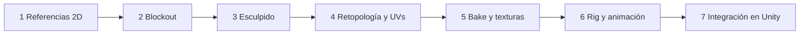

# Pipeline de arte

Cómo un personaje, una pieza de escenario o un objeto pasa de idea a estar en el juego. Todo se hace en Blender. Cada etapa tiene su lista de aprobación: **no se empieza una etapa hasta que la anterior está aprobada**.

Límites, mapas y nombres: [[Estandares de arte]]. Exportar FBX y escala: [[Pipeline]].

## Etapas

| # | Etapa | Sale | Dónde |
|---|---|---|---|
| 1 | [[Etapa 1 - Referencias 2D]] | Hoja de vistas y hoja de detalles | `docs/Referencias/` |
| 2 | [[Etapa 2 - Blockout]] | Formas simples a escala, probadas en el nivel | `<asset>.blend`, colección `Blockout` |
| 3 | [[Etapa 3 - Esculpido]] | Modelo de alta resolución | `<asset>-esculpido.blend`, colección `Alto` |
| 4 | [[Etapa 4 - Retopologia y UVs]] | Modelo bajo con UVs | `<asset>-esculpido.blend`, colección `Bajo` |
| 5 | [[Etapa 5 - Bake y texturas]] | Mapas de normales, oclusión y color | `juego/Assets/_Proyecto/Art/Texturas/` |
| 6 | [[Etapa 6 - Rig y animacion]] | Esqueleto, pesos y animaciones | `<asset>.blend` |
| 7 | [[Etapa 7 - Integracion en Unity]] | Prefab en el nivel | `juego/Assets/_Proyecto/Prefabs/` |

## Qué etapas lleva cada tipo

| Tipo | Etapas | Ejemplo |
|---|---|---|
| Personaje o Guardador | 1 a 7 | Miga, La Costurera |
| Objeto grande o pieza de escenario | 1 a 5 y 7; la 6 solo si se mueve | Máquina de coser, tijeras, armario |
| Objeto pequeño | 1, 2, 4, 5 y 7; sin esculpido, el detalle va en el bisel y la textura | Botón, carrete, dedal |

En un objeto pequeño la hoja de la etapa 1 puede ser solo frente, lado y arriba.

## Cómo se aprueba una etapa

1. Cada asset tiene una issue con la plantilla **Asset de arte**, en el milestone `v0.3.0 - Arte`. La issue trae una casilla por etapa.
2. Se trabaja la etapa en su rama, desde `develop`: `art/<issue>-<asset>-<etapa>`, por ejemplo `art/70-costurera-esculpido`.
3. Al terminar, se revisa la lista de la nota de esa etapa punto por punto.
4. Las capturas que pide la lista van en un comentario de la issue, y se marca la casilla de la etapa.
5. PR hacia `develop` titulado `art: esculpe a la costurera`, con `Refs #70`. El PR de la última etapa lleva `Closes #70`. Un objeto pequeño puede ir en un solo PR con todas sus etapas.
6. Se actualiza el estado en [[Inventario]]: `en proceso (3 esculpido)`.

Si una etapa no pasa, se corrige en esa misma etapa. Si el problema viene de una anterior (una proporción mal en la hoja, por ejemplo), se vuelve a esa etapa y se aprueba otra vez.

## Revisión automática

La prueba `EstandaresDeArtePruebas` (EditMode, en `juego/Assets/_Proyecto/Tests/EditMode/`) corre en cada PR que toca `juego/`. Revisa:

- Prefijos y nombres de modelos, texturas, materiales y animaciones.
- Triángulos de cada modelo contra su límite.
- Que ninguna textura pase de 4096 px.
- Que toda textura `_normal` esté importada como Normal map.

Si sale en rojo, el PR no se fusiona. Lo que la prueba no puede ver (silueta, pliegues, deformación) se revisa con la lista de cada etapa.

## Decisiones
- 2026-11-27: todo el arte se hace en Blender: esculpido, retopología, bake, texturas, rig y animación.
- 2026-11-27: los modelos actuales de [[Miga]] y [[La Costurera]] quedan como provisionales. Se rehacen más adelante con esta pipeline, desde la etapa 1.
- 2026-11-27: los tres mapas `_normal` que ya estaban en el juego se importaban como textura de color; se cambiaron a Normal map.
